# RR73

RR73 is an iPhone home-screen app for radio amateurs that operates FT8, FT4, WSPR and RTTY through the headset jack, with its own Rust decoders and a log that works without a connection.

It runs at https://nnamon.github.io/RR73/, on the iPhone, the iPad and in a desktop browser.

## Setup

1. Open the address in Safari, then Share › Add to Home Screen.
2. Connect the iPhone's headset audio to the radio: receive audio to the phone's microphone input, the phone's headphone output to the radio's audio input. The radio keys on VOX; set it to USB.
3. In Settings, enter the callsign and grid (Use GPS fills the grid), then set the input and the output level in Settings › Radio and audio.
4. In Operate, tap Start audio.

Settings › Practice band plays a band of simulated stations in the app, with no radio and no microphone. Nothing leaves the phone while it is on, and its QSOs go to a separate practice log. The screenshots below were taken on it.

## Walkthrough

### FT8 and FT4

<table>
<tr>
<td>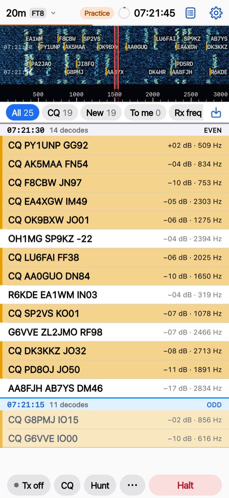</td>
<td>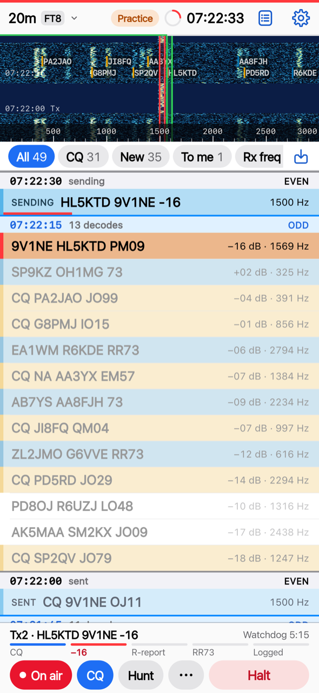</td>
<td>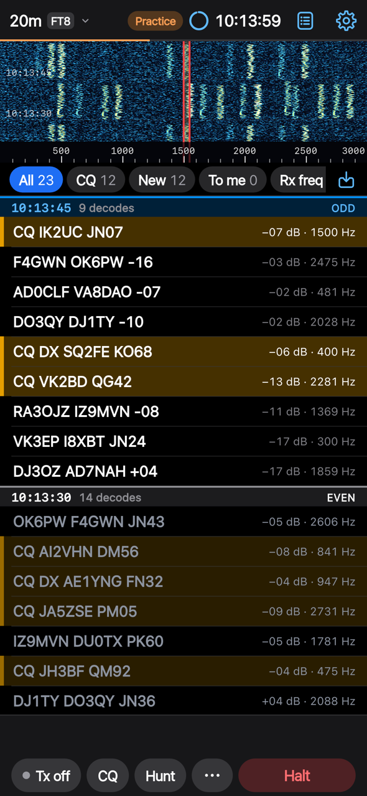</td>
</tr>
</table>

- The waterfall shows 0 to 3000 Hz, with each decoded callsign written over its signal. Drag it to set the Tx frequency; the green marker sets Rx.
- Decodes arrive after each 15 s slot (7.5 s in FT4), newest slot at the top, coloured by category: messages to you, new DXCC entities, grids and calls, CQs, worked before. The colour schemes include one chosen to stay apart with colour blindness. The list keeps the last hour.
- Chips filter the list to CQs, new stations, messages to you or the Rx frequency. Hide worked leaves out stations already in the log on the band and mode.
- A double-tap on a decode calls the station. The six messages go in turn, each in its slot, and the QSO is logged at RR73 or 73. CQ calls CQ; Repeat CQ answers the next caller after each QSO; Hunt answers CQs one after another.
- Halt stops the transmission at once.
- Night display, in ••• or after an idle time, shows the clock, the next transmission and the stations heard in dim red on black. A tap wakes Operate.

### Hound, WSPR and RTTY

<table>
<tr>
<td>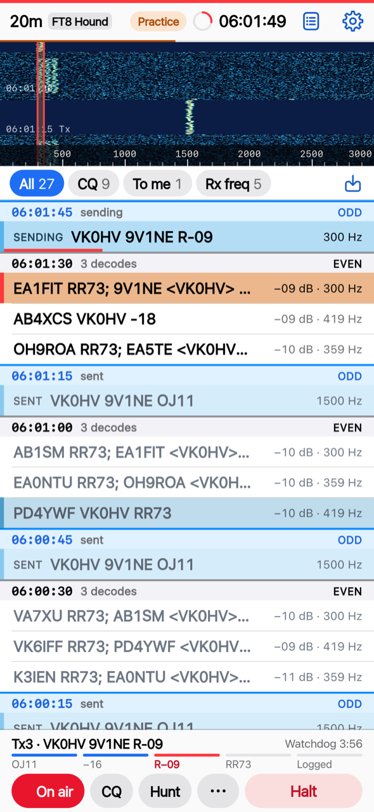</td>
<td>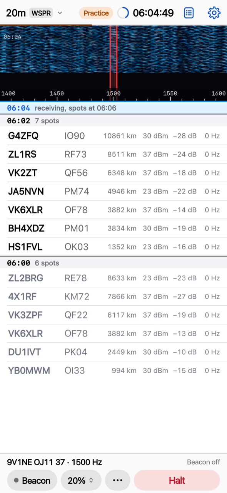</td>
<td>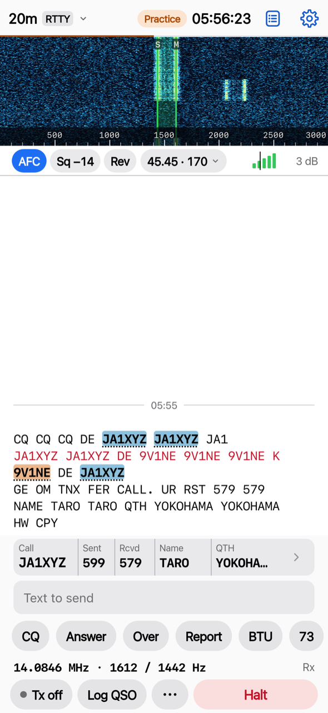</td>
</tr>
</table>

- **Hound** works a DXpedition running FT8 DXpedition mode: Tx1 at 1000 Hz or above, the Fox's report read from its multi-call messages, the R-report on the Fox's frequency.
- **WSPR** decodes each 2 min slot and beacons in 5 to 100% of the slots. With the switch on, spots go to WSPRnet.
- **RTTY** at 45.45 baud and 170 Hz shift: a tap on a callsign in the received text fills the QSO strip from that station's text, and macros send the exchanges, from a QSO set or a contest set with serial numbers.

### Log and activations

<table>
<tr>
<td>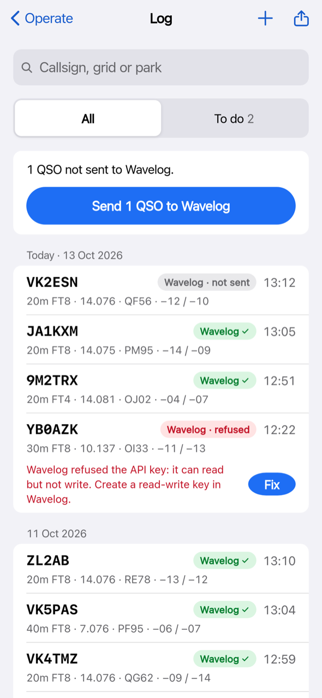</td>
<td>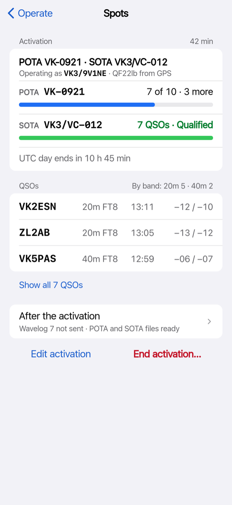</td>
<td>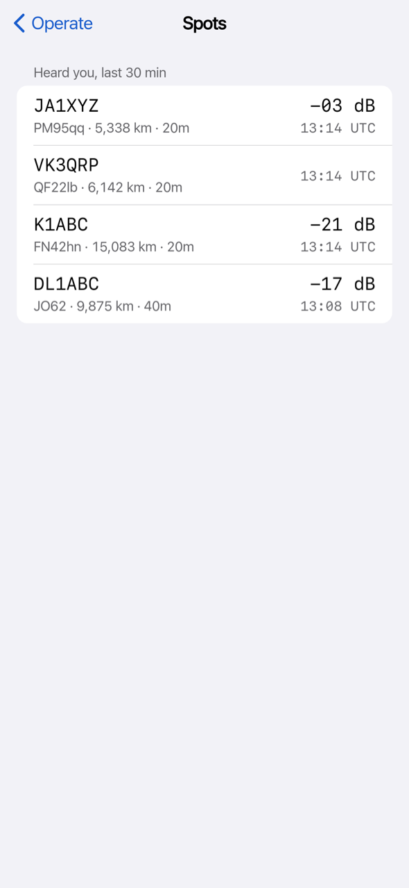</td>
</tr>
</table>

- The log lives on the phone. QSOs go to Wavelog when you send them, or by themselves with Send automatically on; a refusal says why and how to fix it. The log exports ADIF, and Settings › Logging backs it up to one file and imports a backup or ADIF from any logger.
- An activation holds POTA, SOTA, WWFF and IOTA references, counts toward each programme's rule, and builds the POTA, SOTA and WWFF files. POTA and SOTA references come with suggestions from the parks and summits lists: as you type, and the ones near the phone from a GPS fix. A logged QSO can join the running activation.
- Spots lists POTA activators and DX cluster spots, and with Heard you on, the stations PSK Reporter says heard you.

### Relay

QSP is RR73's relay, released with the app. It carries what a web page on an iPhone cannot do itself: receiving from a KiwiSDR web SDR in place of the radio, and reporting your decodes to PSK Reporter over UDP. RR73 works without one, and anyone can run one: see `crates/rr73-qsp/README.md`.

### iPad and desktop

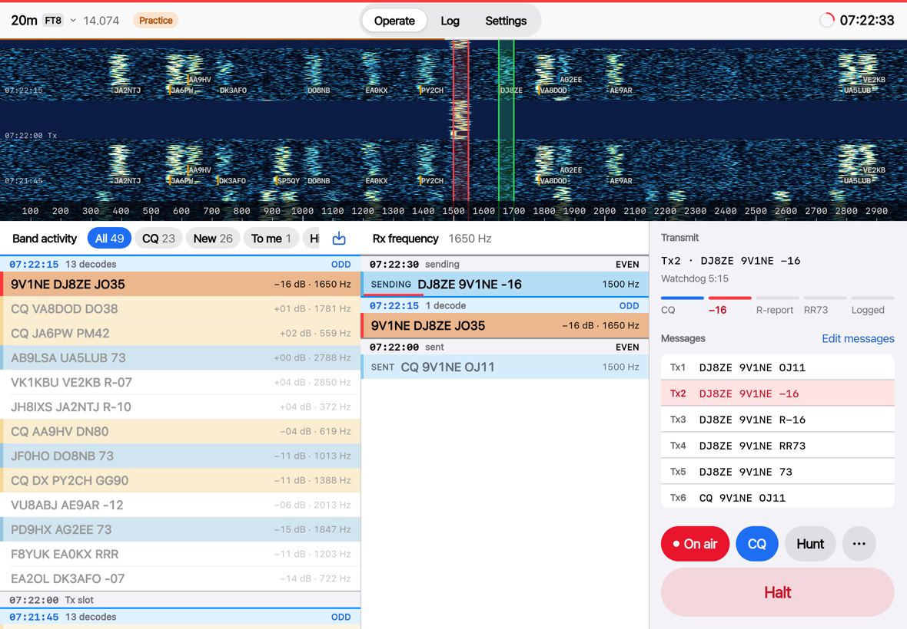

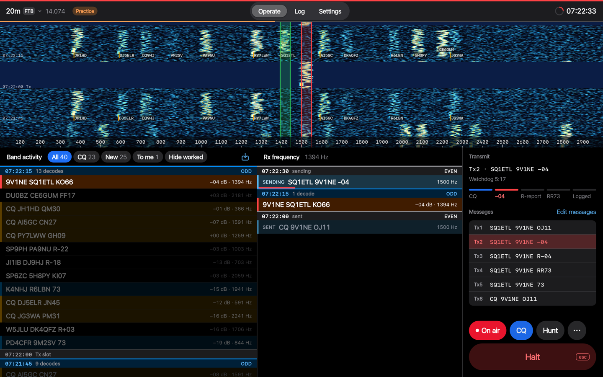

Wide screens show band activity, the Rx frequency list and the transmit panel side by side, with keyboard shortcuts: Esc halts, Return calls the selected station, ? lists the rest.

Every optional feature and every upload is off until you turn it on.

## Repository

| Path | Contents |
| --- | --- |
| `crates/` | Rust: FT8, FT4, WSPR and RTTY codecs, DSP, decoders, channel simulator, corpus format, bench, WebAssembly bindings, and QSP. |
| `web/` | The app: Svelte 5, TypeScript, Vite, installed from Safari to the home screen. |
| `tools/` | ft8_lib oracle, WSJT-X reference tools, KiwiSDR corpus recorder, reference data build, copy lint, release scripts. |
| `docs/` | Architecture, design documents, decision records, testing. |

## Development

Everything runs in Docker; see `AGENTS.md` for the commands and the rules for changes.

```sh
docker compose build
docker compose run --rm rust cargo test --workspace
docker compose run --rm node npm --prefix web ci
docker compose run --rm --service-ports node npm --prefix web run dev
```

## Licence

Dual licensed under the MIT licence or the Apache License 2.0, at your option. See `LICENSE-MIT` and `LICENSE-APACHE`.

Portions of `rr73-ft8` are ported from [ft8_lib](https://github.com/kgoba/ft8_lib) by Kārlis Goba (MIT). The FT8 and FT4 protocols are described in Franke, Somerville and Taylor, "The FT4 and FT8 Communication Protocols", QEX, July/August 2020.
