# RR73

RR73 is an FT8, FT4, LQ8, WSPR and RTTY app for amateur radio operators who want to operate from an iPhone. It runs in Safari, connects to the radio through an audio cable and keys the transmitter by VOX.

The app is at https://nnamon.github.io/RR73/. Once you've added it to the Home Screen it opens and decodes with no network connection.

<table>
<tr>
<td>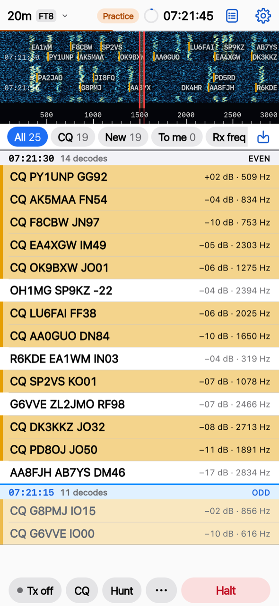</td>
<td>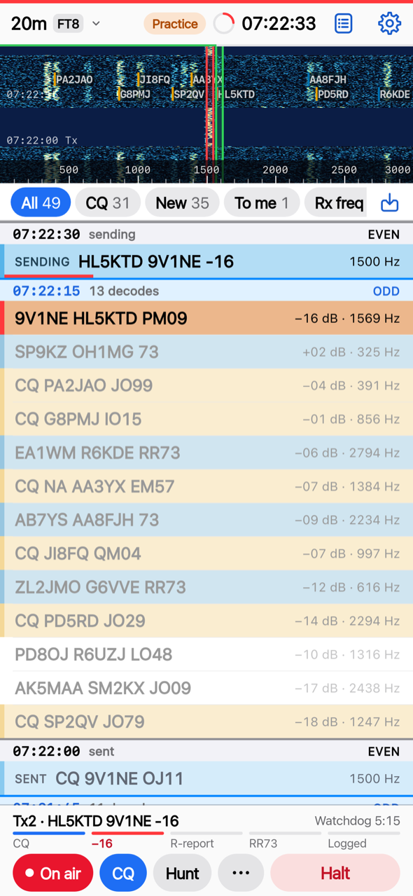</td>
<td>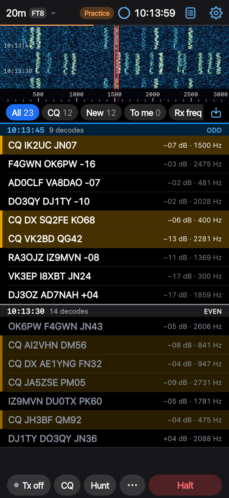</td>
</tr>
</table>

## Features

Every upload and every optional feature stays off until you turn it on in Settings.

### Operating

- Double-tap a decode to work the station. RR73 sends each message in its slot with the report filled in, and logs the QSO when it completes.
- Repeat CQ keeps calling CQ after each QSO and answers callers from a queue, in the order you choose.
- Hunt answers CQs one after another until you stop it, taking unworked stations first.
- Hound mode works FT8 DXpeditions that run Fox and Hound, and reads your report out of the Fox's multi-call messages.
- LQ8 completes a QSO in 4 messages on FT8's signal, because the call carries the grid and report and the answer carries the report and 73. Hunt, Repeat CQ and the practice band all work in LQ8 (`docs/design/lq8.md`).
- Halt is always on screen, and the watchdog stops Tx after 6 min without a touch. You can change the limit in Settings.
- Decode colours mark messages to your call, CQs, new DXCC entities, continents, zones, grids and calls, and stations already worked. One of the colour schemes is designed for colour blindness.
- Chips filter the list to CQ, New, To me or Rx freq, and Hide worked drops stations already logged on the band and mode.
- A Clock badge appears when the phone's clock is 1 s or more off.

### Decoding

- The FT8, FT4, LQ8, WSPR and RTTY decoders are RR73's own, written in Rust and compiled to WebAssembly, and they run on the phone. LQ8's message codec is ported from lq_lib by Luis Quesada HB9IPH (MIT).
- The decoder runs up to 3 passes per FT8 or FT4 slot and subtracts each decoded signal before the next pass, which uncovers weaker signals underneath. Ordered-statistics decoding (OSD) takes the candidates that belief propagation fails on.
- After the slot ends, 2 later stages spend up to 2 s searching finer time and frequency grids.
- First decodes appear 13.5 s into an FT8 slot (6 s into FT4).
- During a QSO, a priori decoding tests weak signals near the other station against the messages it expects next.

### Logging and activations

- The log is kept on the phone and works offline.
- QSOs go to Wavelog when you send them or automatically. When Wavelog refuses one, the log shows the reason and a Fix button.
- Read Wavelog's log counts the QSOs in Wavelog, logged from any station, for decode colours, New and Hide worked. Dupes, Hunt and Repeat CQ count only the phone's log.
- ADIF export and import, and a backup of the whole log in one file.
- POTA, SOTA, WWFF and IOTA activations, with progress towards each programme's target and the time left in the UTC day.
- Park and summit suggestions by name or from the phone's GPS position.
- POTA, SOTA and WWFF upload files for each activation.
- Spots lists POTA activators and DX cluster spots.
- A relay can report your decodes to PSK Reporter, and Heard you lists the stations that heard your signal in the last 30 min.

<table>
<tr>
<td>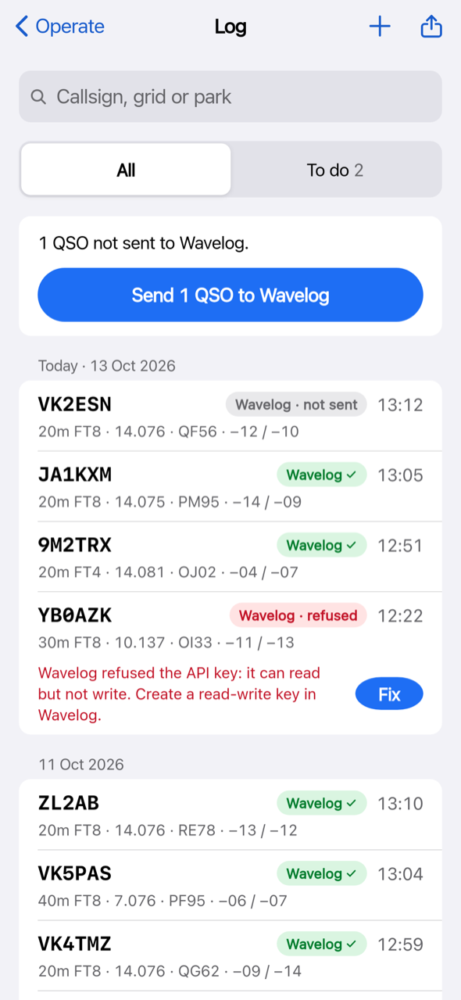</td>
<td>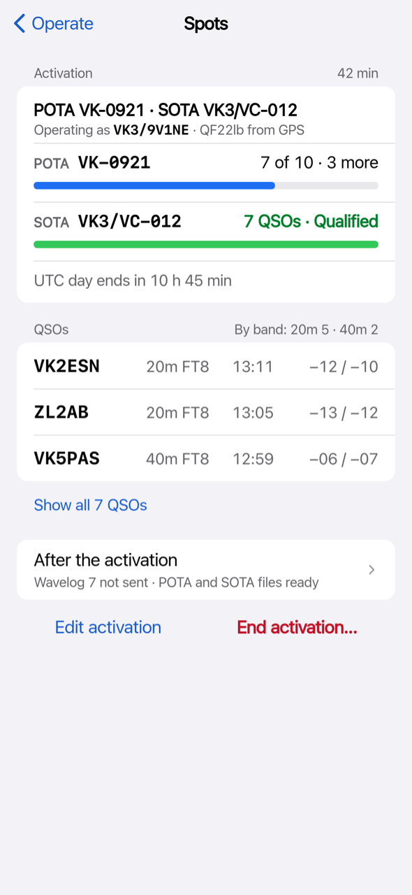</td>
<td>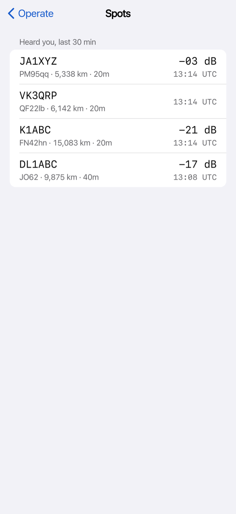</td>
</tr>
</table>

### WSPR and RTTY

- WSPR decodes each 2-minute slot and lists the spots farthest first. RR73 can upload them to WSPRnet.
- The WSPR beacon transmits in a set share of slots, 20% by default.
- RTTY runs at 45.45 baud and 170 Hz shift by default, with other speeds and shifts as presets.
- Tap a callsign in the RTTY text to start a QSO, and RR73 fills in the name, QTH and report from what that station sent.
- RTTY macros, including a contest set that numbers each QSO.

<table>
<tr>
<td>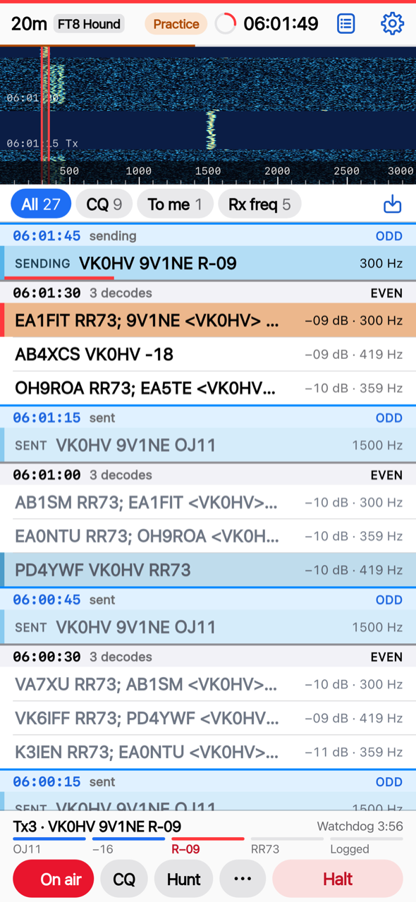</td>
<td>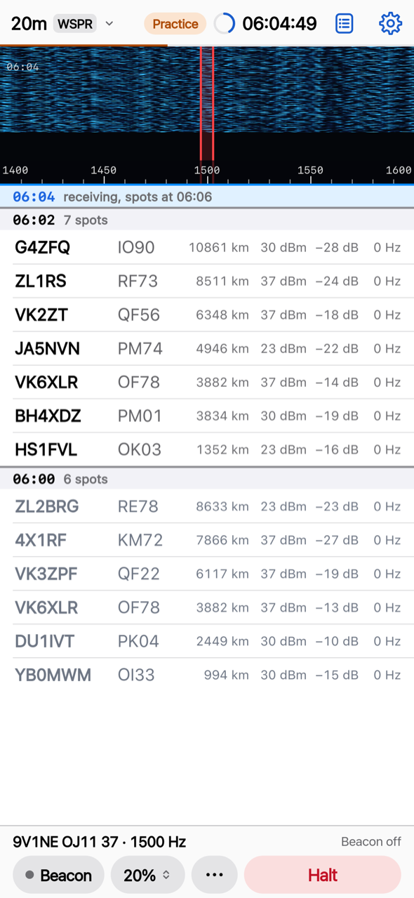</td>
<td>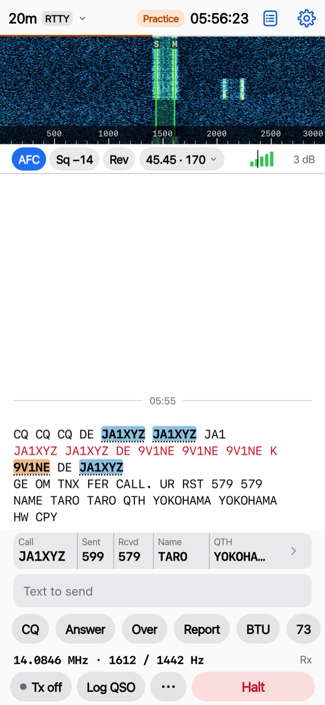</td>
</tr>
</table>

### Receiving without a radio

- A web SDR, reached through a QSP relay, can stand in for the radio's receive audio while Tx still goes to the radio.
- The practice band simulates a busy band with CQs, callers, RTTY stations and a DXpedition, and keeps its QSOs in a separate log.
- Tx audio still plays in practice and can key a connected radio. Turn off Play Tx audio in Settings › Practice band to stop that.

### Display

- Light, Dark and Sun themes, and a night display in dim red on black.
- On an iPad or a desktop, Band activity, Rx frequency and the transmit panel sit side by side.
- With a keyboard, Esc halts and ? lists the other shortcuts.

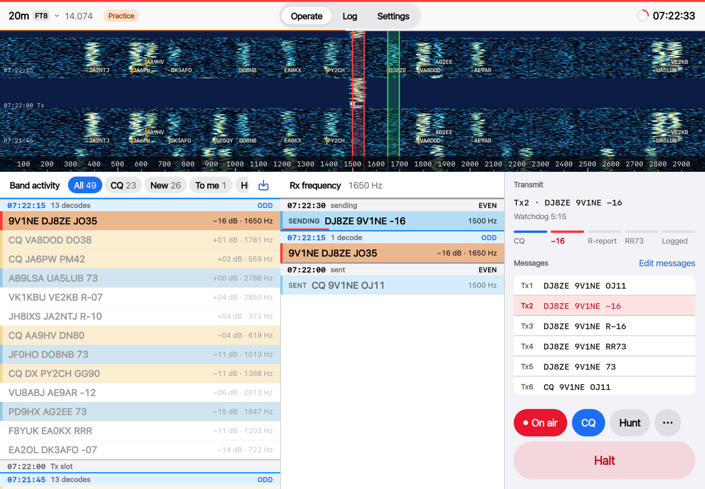

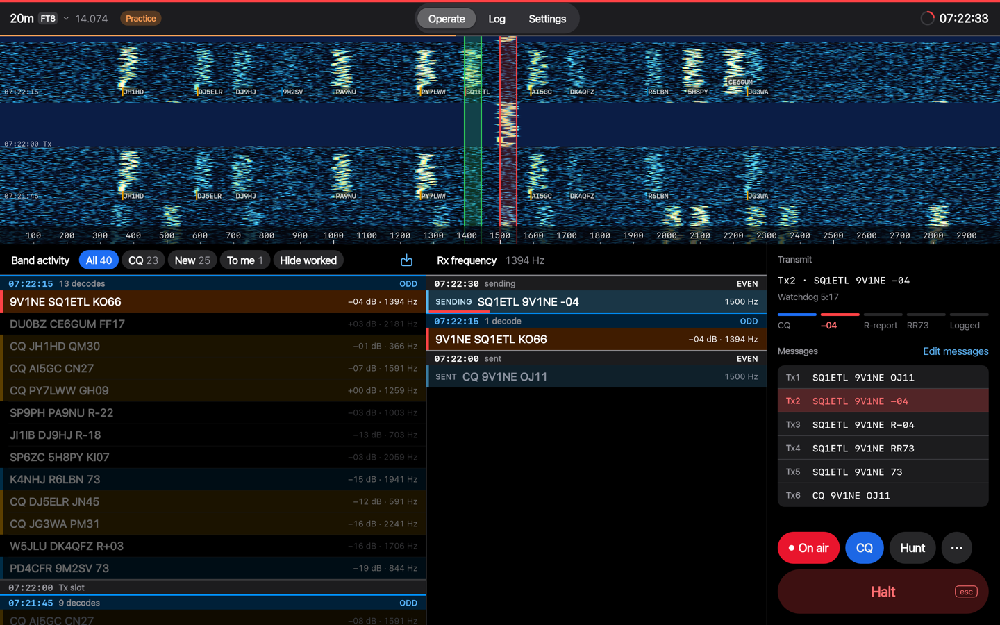

## Decoder measurements

These figures come from `rr73-bench`. SNR is measured in a 2500 Hz bandwidth, and SNR50 is the SNR at which half the messages decode, so a lower figure is better.

| | First stage | With the later stages |
| --- | --- | --- |
| FT8 SNR50, white noise | −21.4 dB | −21.6 dB |
| FT8 SNR50, Watterson fading | −18.6 dB | −19.0 dB |
| FT4 SNR50, white noise | −17.1 dB | −17.6 dB |
| LQ8 SNR50, white noise | −21.3 dB | −21.5 dB |
| LQ8 SNR50, Watterson fading | −18.7 dB | −18.9 dB |
| FT8, reference decodes found in 350 slots recorded on 40m | 95% | 96% |

Neither column gave a false decode in 5000 FT8 or 10000 FT4 noise-only slots, and the later stages gave none in 5000 LQ8 noise-only slots. A priori decoding moves the SNR50 of FT8 replies in a QSO from −21.4 to −22.7 dB, also with no false decodes in 5000 noise-only slots. The method and data sets are in `docs/bench.md`, decision records 0007 and 0009 and experiments 0008, 0011 and 0012.

## Requirements

- An iPhone with iOS 26 and Safari, or an iPad or a desktop browser.
- A cable between the phone's headset audio and the radio's audio in and out, through the headset jack or a USB-C or Lightning headset adapter.
- The radio in USB, keyed by VOX.

The iPhone has no CAT control, so set the band both on the radio and in Change band. In Chrome and Edge on a computer, Settings › Rig control reads and sets an Icom IC-705 over its USB cable or an Elecraft KX2 through a Digirig, and keys the radio once Key the radio with CAT is on (`docs/design/cat.md`).

## Getting started

On the iPhone:

1. Open https://nnamon.github.io/RR73/ in Safari and choose Share › Add to Home Screen.
2. Connect the cable. Set the radio to USB with VOX on.
3. In Settings, enter your callsign and grid, or tap Use GPS to fill in the grid.
4. Set the input and output levels in Settings › Radio and audio.
5. In Operate, choose the band and tap Start audio. The start chime keys the radio through VOX.

On a Windows computer or tablet, in Chrome or Edge, with an IC-705:

1. Install Icom's USB Driver from the IC-705's page on icomjapan.com before you plug in the radio. It includes the radio's USB audio driver.
2. Connect the radio's USB cable.
3. Open https://nnamon.github.io/RR73/ and install it: select Install at the right of the address bar (App available in Edge). The browser's menu has it too: Cast, save, and share › Install page as app in Chrome, More tools › Apps › Install this site as an app in Edge.
4. In Settings, enter your callsign and grid.
5. In Settings › Radio and audio, tap Start audio and allow the microphone. If Windows blocks it, turn on Let desktop apps access your microphone in Windows Settings › Privacy & security › Microphone.
6. Choose the IC-705's USB audio as Input and as Output. Windows usually names both USB Audio CODEC. Keep another device as the default output in Windows Settings › System › Sound, so that Windows sounds stay off the air.
7. Set the clock: in Windows Settings › Time & language › Date & time, turn on Set time automatically and select Sync now.
8. Connect the radio in Settings › Rig control, and follow the first session in `docs/design/cat.md` before turning on Key the radio with CAT.

RR73 keeps receiving and transmitting while its window is minimised or behind another one.

### Desktop app

The desktop app for Windows, macOS and Linux is the same app in its own window. It adds rig control on every system through the computer's serial ports, and corrects slot and Tx timing against an NTP server, with the measured offset in Settings › Radio and audio › Timing (`docs/design/desktop.md`). Each release on GitHub carries the installers: `.exe` (NSIS) or `.msi` for Windows, `.dmg` for macOS (Apple silicon and Intel), and `.AppImage` or `.deb` for Linux.

The installers are not signed, so Windows and macOS show a warning before the first start.

- Windows: SmartScreen says Windows protected your PC. Select More info, then Run anyway.
- macOS: the system says the app cannot be opened because Apple cannot check it. Open the `.dmg`, drag RR73 to Applications and open it once. Then, in System Settings › Privacy & Security, select Open Anyway beside the message about RR73 and confirm with Open. On macOS 14 and earlier, Control-click RR73 in Applications, choose Open, and confirm with Open.
- Linux: make the AppImage executable (`chmod +x RR73_*.AppImage`) and run it, or install the `.deb` with `sudo apt install ./RR73_*.deb`. Rig control needs access to the serial port: add your user to the `dialout` group (`uucp` on Arch Linux) and log in again.

To try RR73 without a radio, turn on Settings › Practice band.

## Relay

QSP, in `crates/rr73-qsp`, is an optional relay server. It carries web SDR audio, which a page in Safari can't open over plain `ws://`, and PSK Reporter reports, which travel over UDP. The app ships with no relay set up, so add one in Settings › Relay.

Anyone can run a relay. Each release includes QSP binaries for x86-64 and ARM64 Linux and the image `ghcr.io/nnamon/rr73-qsp`, and `crates/rr73-qsp/README.md` covers the setup.

## Repository

| Path | Contents |
| --- | --- |
| `crates/` | Rust: FT8, FT4, WSPR and RTTY codecs, DSP, decoders, channel simulator, corpus format, bench, WebAssembly bindings, and QSP. |
| `web/` | The app: Svelte 5, TypeScript, Vite. |
| `tools/` | FT8 codec test oracle, reference decoder tools, web SDR corpus recorder, reference data build, copy lint, release scripts. |
| `docs/` | Architecture, design documents, decision records, experiments, testing. |

## Development

Everything runs in Docker, and `AGENTS.md` lists the commands and the rules for changes. These build the images, run the Rust tests, install the web dependencies and start the app's dev server:

```sh
docker compose build
docker compose run --rm rust cargo test --workspace
docker compose run --rm node npm --prefix web ci
docker compose run --rm --service-ports node npm --prefix web run dev
```

## Licence

Dual licensed under the MIT licence or the Apache License 2.0, at your option. See `LICENSE-MIT` and `LICENSE-APACHE`.

Portions of `rr73-ft8` are ported from [ft8_lib](https://github.com/kgoba/ft8_lib) by Kārlis Goba (MIT). The FT8 and FT4 protocols are described in Franke, Somerville and Taylor, "The FT4 and FT8 Communication Protocols", QEX, July/August 2020.

The reset arrow in Change band is the `rotate-ccw` icon from [Lucide](https://lucide.dev) (ISC). Both licences are in `THIRD_PARTY_NOTICES.md`, and the app shows them in Settings › About › Credits.
