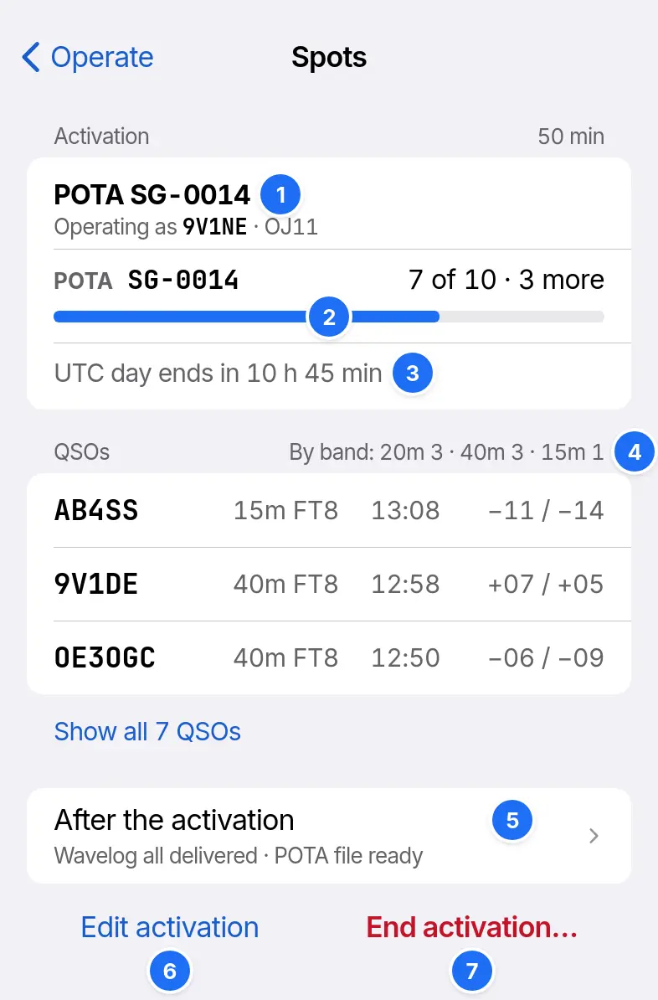

# Activations

An activation ties the QSOs you log to one or more POTA, SOTA, WWFF or IOTA references. Turn on Activations in Settings › Optional features.

## Starting an activation

In Spots, tap Start activation, add each reference, check Callsign on air and Grid, and tap Start activation. FT8 and FT4 messages then carry that callsign and grid. One activation holds at most 1 summit, 1 WWFF reference and 1 island.

| Programme | Reference | Target |
| --- | --- | --- |
| POTA | `VK-0921` | 10 QSOs in one UTC day |
| SOTA | `VK3/VC-012` | 4 stations in one UTC day |
| WWFF | `VKFF-0921` | 44 QSOs over every activation at the reference |
| IOTA | `OC-001` | None |

Find nearby parks and summits lists those near your GPS position.

## Progress

1. The references, the callsign on air and the grid.
2. Progress to the target. It reads Qualified once met.
3. Time left in the UTC day.
4. QSOs, counted by band. Tap one to edit it.
5. Files and Wavelog, for after the activation.
6. Edit activation: references, callsign, grid and Wavelog station.
7. End activation keeps the QSOs on the device.

The strip above Operate's waterfall shows the same progress, such as `POTA SG-0014 · 7 of 10`.

## Dupes in an activation

A new activation starts with no [dupes](making-qsos.md#dupes), even at the same park.

## Where the QSOs go

| Destination | Gets |
| --- | --- |
| Wavelog | Each QSO, at the station location chosen for the activation |
| POTA file | The QSOs for pota.app |
| SOTA file | The QSOs for the SOTA database |
| WWFF file | The QSOs for your WWFF coordinator |
| ADIF file | The QSOs with every field |

Settings › Logging turns the files on. After the activation opens Log › Activations, where Share sends a file and Mark submitted records the upload.
