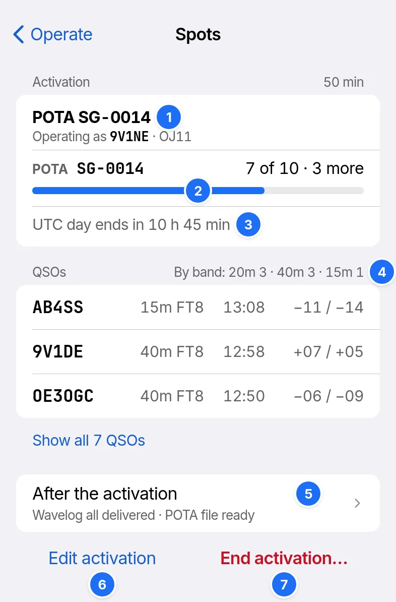

# Activations

An activation ties the QSOs you log to one or more POTA, SOTA, WWFF or IOTA references and tracks your progress to each programme's target. Turn on Activations in Settings › Optional features to use it.

## Starting an activation

1. In Spots, tap Start activation.
2. Add each reference. One activation holds at most 1 summit, 1 WWFF reference and 1 island.
3. Check Callsign on air and Grid. FT8 and FT4 messages carry these for the rest of the activation.
4. Tap Start activation.

| Programme | Reference | Target |
| --- | --- | --- |
| POTA | `VK-0921` | 10 QSOs in one UTC day |
| SOTA | `VK3/VC-012` | 4 stations in one UTC day |
| WWFF | `VKFF-0921` | 44 QSOs over every activation at the reference |
| IOTA | `OC-001` | None |

To find a reference, tap Find nearby parks and summits, which lists those near your GPS position.

## Progress

1. The references, the callsign on air and the grid.
2. Progress to the target, which reads Qualified once you meet it.
3. Time left in the UTC day.
4. QSOs, counted by band. Tap one to edit it.
5. Files and Wavelog, for after the activation.
6. Edit activation: references, callsign, grid and Wavelog station.
7. End activation. The QSOs stay on the device.

While the activation runs, the strip above Operate's waterfall shows the same progress, such as `POTA SG-0014 · 7 of 10`.

## Dupes in an activation

A new activation starts with no [dupes](making-qsos.md#dupes), even at the same park, so you can work the same stations again.

## Where the QSOs go

| Destination | Gets |
| --- | --- |
| Wavelog | Each QSO, at the station location chosen for the activation |
| POTA file | The QSOs for pota.app |
| SOTA file | The QSOs for the SOTA database |
| WWFF file | The QSOs for your WWFF coordinator |
| ADIF file | The QSOs with every field |

Turn on the files you need in Settings › Logging. Once you're done operating, tap the After the activation row to open Log › Activations, where Share sends a file and Mark submitted records that you've uploaded it.
