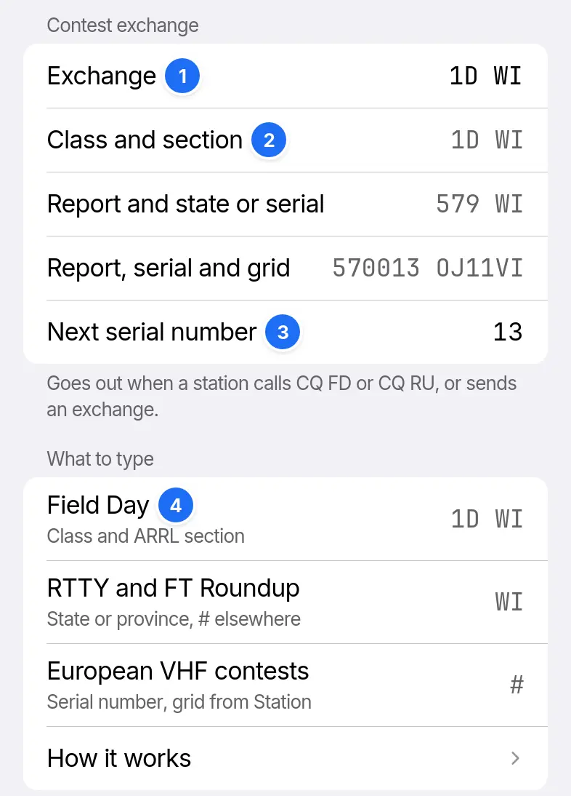

# Contest exchange

Type your exchange in Settings › FT8 and FT4, as you would say it on the air. Empty, RR73 sends standard messages only.



1. Exchange.
2. What goes out in each format, to a station at −10 dB, or the part missing.
3. Next serial number, sent for `#`.
4. What to type for each contest.

## What to type

| Contest | Type |
| --- | --- |
| Field Day | Class and ARRL or RAC section: `1D WI` |
| RTTY Roundup, FT Roundup | US state or Canadian province: `WI`. Elsewhere `#`, for a serial number |
| European VHF | `#`, for a serial number and the 6-character grid from Settings › Station |

## When it is used

Answering CQ FD or CQ RU, your first message carries the exchange. A reply with an exchange moves any QSO to that format, and a grid moves it back. To call CQ FD, edit Tx6 in Edit messages.

## What goes on air

Field Day:

```ladder
Them: CQ FD AB4SS EM73
You: AB4SS 9V1NE 1D WI | Class and section
Them: 9V1NE AB4SS R 2A TN
You: AB4SS 9V1NE RR73 | Logged
```

Roundup, from outside the US and Canada:

```ladder
Them: CQ RU AB4SS EM73
You: AB4SS 9V1NE 579 0013 | Report and serial number
Them: 9V1NE AB4SS R 589 TN
You: AB4SS 9V1NE RR73 | Logged
```

European VHF, with both callsigns hashed:

```ladder
Them: CQ TEST OE3OGC JN88
You: OE3OGC 9V1NE OJ11 | Tx1 carries your grid
Them: <9V1NE> <OE3OGC> 570021 JN88UF | Their exchange sets the format
You: <OE3OGC> <9V1NE> R 590013 OJ11VI | Report, serial number and grid
Them: 9V1NE OE3OGC RR73 | Logged
```

The report digit follows the station's SNR in 4 dB steps from 2 to 9, with 7 at −10 dB.

## Serial numbers

The serial number goes out as 4 digits and counts up by 1 each time a QSO that sent it is logged. Roundup takes 1 to 7999 and European VHF 0 to 2047. Outside those the status line says `Serial number out of range`.

## In the log

| Field | Holds |
| --- | --- |
| Exchange sent, Exchange received | The exchange without the report: `1D WI` or `0013 OJ11VI` |
| Report sent, Report received | The report as on air, 579 or 57. Empty for Field Day |
| Their grid | The grid of a European VHF exchange |

ADIF export writes a serial number to STX and SRX and any other exchange to STX_STRING and SRX_STRING.
