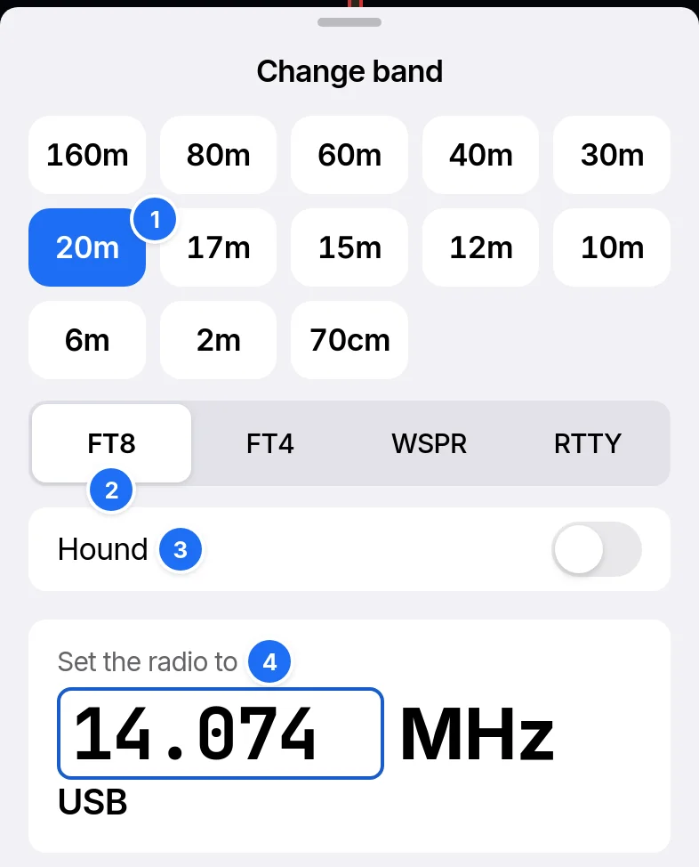

# Getting started

RR73 runs in Safari on an iPhone or iPad, in Chrome or Edge on a computer, and in [the desktop app](your-radio.md#the-desktop-app).

## Installing

| Device | Steps |
| --- | --- |
| iPhone or iPad | Open RR73 in Safari, choose Share › Add to Home Screen, then open RR73 from its icon. It then starts with no network |
| Computer | Open RR73 in Chrome or Edge. Rig control works only in these and in the desktop app |

## Callsign and grid

Enter Callsign and Grid in Settings › Station, or tap Use GPS. RR73 transmits only with both set.

## Starting audio

Connect the radio's audio, as [Your radio](your-radio.md) shows, and tap Start audio on Operate. Decodes appear 13.5 s into each 15 s FT8 slot.

The start chime keys the radio through VOX. Settings › Radio and audio turns it off. On an iPhone, audio stops when you leave the app. Resume audio starts it again.

## Change band

1. Band. Tap the band on Operate's bar to open this sheet.
2. Mode.
3. Hound, for working a DXpedition's Fox.
4. The dial to set on the radio. With rig control, RR73 sets it.

## The bar along the top

| Badge | Shows while | Tap opens |
| --- | --- | --- |
| Clock | The clock is 1 s or more off | [Timing](timing.md) |
| Radio | Rig control is on: green connected, amber connecting or needing a change, red with no connection | Rig control |
| Spots | Activations, POTA spots, Cluster spots or Show who heard you is on | Spots |

On an iPad or a computer the bar stays above every screen, with tabs for Operate, Log, Spots and Settings.
