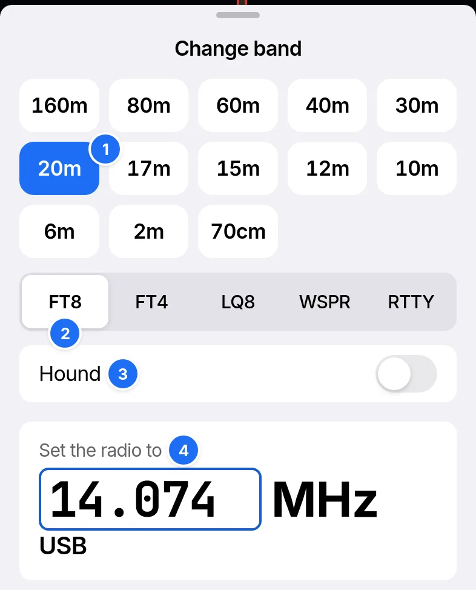

# Getting started

RR73 runs in Safari on an iPhone or iPad, in Chrome or Edge on a computer, and as [the desktop app](your-radio.md#the-desktop-app).

## Installing

| Device | Steps |
| --- | --- |
| iPhone or iPad | Open RR73 in Safari, choose Share › Add to Home Screen, and open it from the new icon. Opened that way, it starts with no network |
| Computer | Open RR73 in Chrome or Edge. Rig control works only in these browsers and in the desktop app |

## Callsign and grid

RR73 won't transmit until it has your callsign and grid. Enter them in Settings › Station, where Use GPS sets the grid from your position.

## Starting audio

1. Connect the radio's audio as [Your radio](your-radio.md) shows.
2. Tap Start audio on Operate. Decodes appear 13.5 s into each 15 s FT8 slot.

The start chime keys the radio through VOX when audio starts. If you don't want that, turn it off in Settings › Radio and audio. On an iPhone, audio stops when you leave the app, and Resume audio starts it again when you come back.

## Change band

Tap the band on Operate's bar to open the Change band sheet.

1. Band.
2. Mode.
3. Hound, for working a DXpedition's Fox.
4. The dial to set on the radio. With rig control on, RR73 sets it for you.

## The bar along the top

Badges appear on Operate's bar only while there's something to show. Tap one to open its screen.

| Badge | Shows while | Tap opens |
| --- | --- | --- |
| Clock | The clock is 1 s or more off | [Timing](timing.md) |
| Radio | Rig control is on: green when connected, amber while connecting or when the radio needs a change, red with no connection | Rig control |
| Spots | Activations, POTA spots, Cluster spots or Show who heard you is on | Spots |

On an iPad or a computer the bar stays above every screen and adds tabs for Operate, Log, Spots and Settings.
