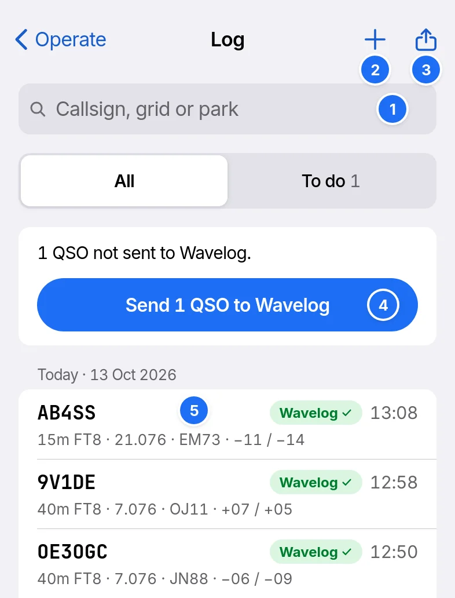
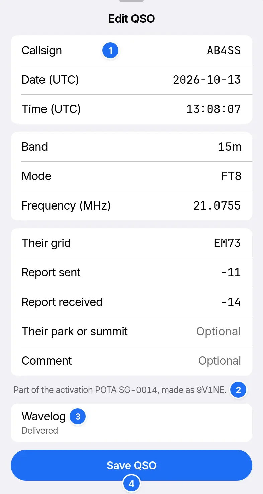

# Logging

The log is on the device and works with no network. Open it with Log on Operate.

1. Search by callsign, grid, park or summit.
2. Add a QSO by hand.
3. Export the QSOs in view as an ADIF file.
4. Send the QSOs waiting for Wavelog.
5. A QSO. Tap it to edit it.

To do lists QSOs not sent to Wavelog, refused or changed, and activation files not submitted. Log shows the [practice log](practice-band.md#the-practice-log) while the practice band is on.

## Editing a QSO

1. The QSO's fields. RTTY QSOs add Name and QTH, contest QSOs the exchanges.
2. The activation it belongs to.
3. Where it has gone. Send to Wavelog shows here until it goes.
4. Save QSO. Delete QSO, under it, has Undo.

## Wavelog

1. In Settings › Logging › Wavelog, type your Wavelog's Address.
2. Paste a read-write API key from Wavelog's API page.
3. Tap Test connection.
4. Choose the Station location. Its callsign must match the one on air.
5. Turn on Use Wavelog.

| Setting | Effect |
| --- | --- |
| Send automatically | Sends each QSO as it is logged. Off, Log shows Send to Wavelog |
| Send edits to QSOs already sent | Wavelog takes no edits. Repeat each edit there |
| Send radio status | Shows RR73 in Wavelog as a radio, with its dial and mode |
| Read Wavelog's log | Reads every QSO Wavelog holds, for the decode colours, New and Hide worked. Dupes, Hunt and Repeat CQ use this device's log only |

A refused QSO shows the reason in Log, with Fix or Send again. QSOs wait while the device is offline.

## Backup and import

| Action, in Settings › Logging › Backup | Effect |
| --- | --- |
| Back up the log | Saves every QSO, activation and Wavelog state to one file. Settings and the API key stay out |
| Import a log | Reads a backup or any ADIF file. It skips QSOs the log holds, and imported QSOs are not sent to Wavelog |

Turn off the practice band to back up or import.
