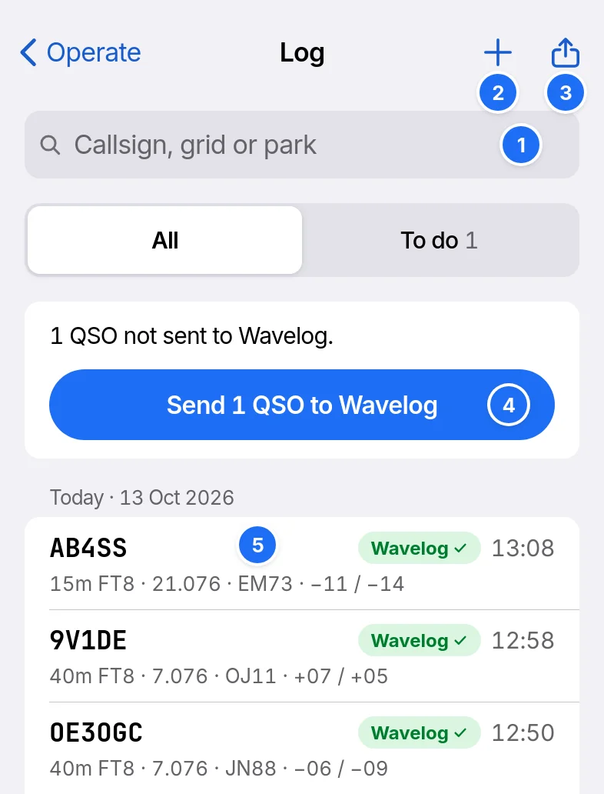
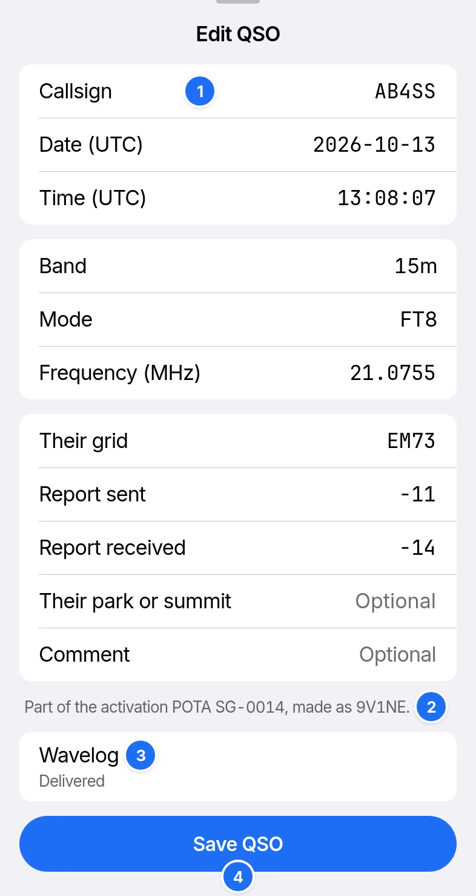

# Logging

The log lives on the device and works with no network. Open it with Log on Operate.

1. Search by callsign, grid, park or summit.
2. Add a QSO by hand.
3. Export the QSOs in view as an ADIF file.
4. Send the QSOs waiting for Wavelog.
5. A QSO. Tap it to edit it.

To do lists what still needs your attention: QSOs that are unsent, refused by Wavelog or changed since sending, and activation files you haven't submitted. While the practice band is on, Log shows the [practice log](practice-band.md#the-practice-log) instead.

## Editing a QSO

1. The QSO's fields. RTTY QSOs add Name and QTH, and contest QSOs add the exchanges.
2. The activation it belongs to.
3. Where the QSO has gone. Send to Wavelog shows here until it has gone there.
4. Save QSO. Delete QSO, under it, offers Undo.

## Wavelog

1. In Settings › Logging › Wavelog, type your Wavelog's Address.
2. Paste a read-write API key from Wavelog's API page.
3. Tap Test connection.
4. Choose the Station location. Its callsign has to match the one you use on air.
5. Turn on Use Wavelog.

| Setting | Effect |
| --- | --- |
| Send automatically | Sends each QSO as it is logged. With it off, send from Log with Send to Wavelog |
| Send edits to QSOs already sent | Wavelog takes no edits, so repeat each edit in Wavelog |
| Send radio status | Shows RR73 in Wavelog as a radio, with its dial and mode |
| Read Wavelog's log | Reads every QSO Wavelog holds for the decode colours, New and Hide worked. Dupes, Hunt and Repeat CQ still use only this device's log |

When Wavelog refuses a QSO, Log shows the reason with Fix or Send again. QSOs wait while the device is offline.

## Backup and import

| Action, in Settings › Logging › Backup | Effect |
| --- | --- |
| Back up the log | Saves every QSO, activation and Wavelog state to one file. Settings and the API key aren't included |
| Import a log | Reads a backup or any ADIF file. It skips QSOs the log already holds, and doesn't send imported QSOs to Wavelog |

Backup and import wait until you turn off the practice band.
