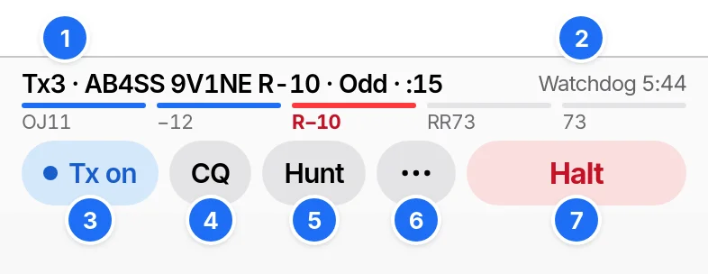

# Making QSOs

RR73 runs the QSO for you: it sends each message in its slot, fills in the reports and logs the QSO when it completes. Before your first QSO, set your callsign and grid in Settings and start audio.

## The transmit controls



1. Status line, with the message going out next and the slot and second it goes in. The bars under it show how far the QSO has got.
2. Time left before the watchdog stops Tx.
3. Tx turns transmitting on or off, and reads On air while RR73 transmits.
4. CQ.
5. Hunt, which answers CQs one after another.
6. •••, with the other actions and switches.
7. Halt stops any transmission, turns Tx off and stops Hunt. Esc does the same.

## Answering a CQ

```ladder
Them: CQ AB4SS EM73
You: AB4SS 9V1NE OJ11 | Tx1, after a double-tap on the CQ
Them: 9V1NE AB4SS -12
You: AB4SS 9V1NE R-10 | Tx3: R and your report
Them: 9V1NE AB4SS RR73 | Logged
You: AB4SS 9V1NE 73 | Tx5, then Tx goes off
```

If a station calls you first, double-tap its message and RR73 answers from the step the QSO has reached. A station that sends RR73 before your R-report has gone out ends the QSO, and RR73 doesn't log it.

To call a station you haven't decoded, use Call a station in •••. A call started up to 4 s late (1.25 s in FT4) still goes out in that slot.

## Calling CQ

```ladder
You: CQ 9V1NE OJ11 | Tx6, after a tap on CQ
Them: 9V1NE AB4SS EM73
You: AB4SS 9V1NE -12 | Tx2: their report
Them: 9V1NE AB4SS R-08
You: AB4SS 9V1NE RR73 | Tx4. Logged
```

CQ repeats until someone calls. If a caller stays silent through 3 repeats, RR73 drops them and goes on to the next caller, or back to CQ.

## After RR73

```ladder
You: AB4SS 9V1NE RR73 | Logged
Them: 9V1NE AB4SS R-08 | AB4SS missed your RR73
You: AB4SS 9V1NE RR73 | Sent again, up to 3 times. The log keeps 1 entry
Them: 9V1NE AB4SS 73 | The QSO ends
```

If they stay silent instead, the QSO ends too.

## No reply

```ladder
You: AB4SS 9V1NE OJ11
Them:
You: AB4SS 9V1NE OJ11 | Repeat 1 of 3
Them:
You: AB4SS 9V1NE OJ11 | Repeat 2 of 3
Them:
You: AB4SS 9V1NE OJ11 | Repeat 3 of 3
Them: | Status line: No reply from AB4SS
```

Tx stays on after the third repeat. Double-tap the station to call again.

## A station that answers someone else

```ladder
You: AB4SS 9V1NE OJ11
Them: OE3OGC AB4SS -09 | Status line: AB4SS answered OE3OGC
You: | Tail-end waits
Them: OE3OGC AB4SS RR73
You: AB4SS 9V1NE OJ11 | Tail-end calls once more
```

Tail-end, in Settings › FT8 and FT4, is on by default and gives up after 8 slots. With it off, your call pauses as soon as the station answers someone else.

## Options in •••

| Option | Effect |
| --- | --- |
| Repeat CQ | After each QSO from CQ, answers the next caller or calls CQ again. Off by default |
| Answer order | Who goes first among callers: First, Strongest, Weakest, Farthest or New |
| Stop after this QSO | Turns Tx off when this QSO ends |
| End QSO | Stops Tx and Hunt without logging |
| Call a station | Calls a callsign you type |
| Transmit in | 1st (Even), the default, or 2nd (Odd) |
| Edit messages | Edits to Tx6, such as `CQ POTA 9V1NE OJ11`, stay. Edits to Tx1 to Tx5 last until the next station |
| Work dupes | Answers dupes after every other caller |
| Hunt order | Not worked, the default, puts stations not worked on this band and mode first |

## Hunt

Hunt works one CQ after another until you stop it, calling the first CQ it hears in each slot. It calls a silent station 4 times, and moves on at once if the station answers someone else. Starting CQ stops Hunt, and starting Hunt stops CQ.

| CQ | Hunt answers |
| --- | --- |
| CQ, CQ POTA, CQ SOTA, CQ WWFF, CQ IOTA, CQ QRP | Always |
| CQ EU and the other continents | When you are on that continent |
| CQ DX | When you are on another continent from the caller |
| CQ JA and other prefixes | When you are in that DXCC entity |
| CQ TEST, CQ FD | Never |

Hunt skips dupes, stations it has heard sending anything other than CQ, and stations that ignored it in the last 10 min.

## Logging

Each logged QSO shows a notice such as `Logged AB4SS 20m FT8 −08 / −11` for 10 s, with Edit and Undo. If audio stops after reports have gone both ways, tap Log QSO on the audio strip to log the QSO anyway.

## Dupes

A dupe is a station already in this device's log on the same band, mode and UTC day, and in the same activation. Repeat CQ and Hunt skip dupes, but a station you call yourself is always called.

## Watchdog

The watchdog stops Tx and Hunt after 6 min with no touch, click or key press, so an unattended station doesn't keep transmitting. A QSO under way finishes first. Change the limit, or turn the watchdog off, in Settings › FT8 and FT4.
