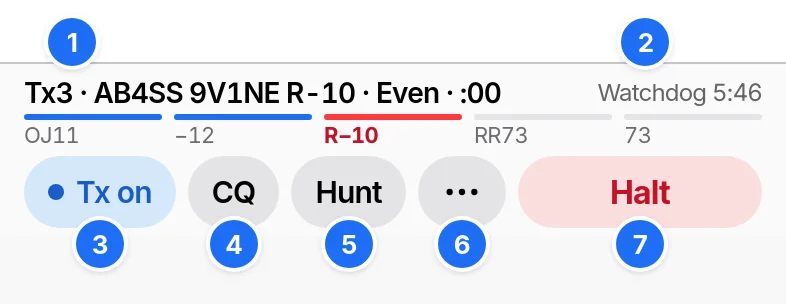

# Making QSOs

RR73 sends each message in its slot, fills in the reports and logs the QSO when it completes. Set your callsign and grid in Settings and start audio first.

## The transmit controls



1. Status line: the message going next, its slot and second. The bars under it show the QSO's progress.
2. The watchdog's time left.
3. Tx: turns transmitting on or off. It reads On air while transmitting.
4. CQ: calls CQ.
5. Hunt: answers CQs one after another.
6. •••: the other actions and switches.
7. Halt: stops any transmission, turns Tx off and stops Hunt. Esc does the same.

## Answering a CQ

```ladder
Them: CQ K1ABC FN42
You: K1ABC 9V1NE OJ11 | Tx1, after a double-tap on the CQ
Them: 9V1NE K1ABC -12
You: K1ABC 9V1NE R-10 | Tx3: R and your report
Them: 9V1NE K1ABC RR73 | Logged
You: K1ABC 9V1NE 73 | Tx5, then Tx goes off
```

Double-tap a message to you and RR73 answers from the step it has reached. A station that sends RR73 before your R-report has gone ends the QSO unlogged.

Call a station, in •••, calls a station you have not decoded. A call up to 4 s late (1.25 s in FT4) still goes out in that slot.

## Calling CQ

```ladder
You: CQ 9V1NE OJ11 | Tx6, after a tap on CQ
Them: 9V1NE K1ABC FN42
You: K1ABC 9V1NE -12 | Tx2: their report
Them: 9V1NE K1ABC R-08
You: K1ABC 9V1NE RR73 | Tx4. Logged
```

CQ repeats until someone calls. A caller silent through 3 repeats is dropped, and the next caller or CQ follows.

## After RR73

```ladder
You: K1ABC 9V1NE RR73 | Logged
Them: 9V1NE K1ABC R-08 | K1ABC missed your RR73
You: K1ABC 9V1NE RR73 | Sent again, up to 3 times. The log keeps 1 entry
Them: 9V1NE K1ABC 73 | The QSO ends
```

Silence also ends the QSO.

## No reply

```ladder
You: K1ABC 9V1NE OJ11
Them:
You: K1ABC 9V1NE OJ11 | Repeat 1 of 3
Them:
You: K1ABC 9V1NE OJ11 | Repeat 2 of 3
Them:
You: K1ABC 9V1NE OJ11 | Repeat 3 of 3
Them: | Status line: No reply from K1ABC
```

Tx stays on. Double-tap the station to call again.

## A station that answers someone else

```ladder
You: K1ABC 9V1NE OJ11
Them: JA1KXM K1ABC -09 | Status line: K1ABC answered JA1KXM
You: | Tail-end waits
Them: JA1KXM K1ABC RR73
You: K1ABC 9V1NE OJ11 | Tail-end calls once more
```

Tail-end is in Settings › FT8 and FT4, on by default. It gives up after 8 slots. Off, the call pauses at once.

## Options in •••

| Option | Effect |
| --- | --- |
| Repeat CQ | After each QSO from CQ, answers the next caller or calls CQ again. Off by default |
| Answer order | Who goes first among callers: First, Strongest, Weakest, Farthest or New |
| Stop after this QSO | Turns Tx off when this QSO ends |
| End QSO | Stops Tx and Hunt without logging |
| Call a station | Calls a callsign you type |
| Transmit in | 1st (Even), the default, or 2nd (Odd) |
| Edit messages | Edits to Tx6, such as `CQ POTA 9V1NE OJ11`, stay. Edits to Tx1 to Tx5 last until the next station |
| Work dupes | Answers dupes after every other caller |
| Hunt order | Not worked, the default, puts stations not worked on this band and mode first |

## Hunt

Hunt calls the first CQ heard in each slot, until you stop it. It calls a silent station 4 times, and moves on at once when the station answers someone else. Hunt and CQ stop each other.

| CQ | Hunt answers |
| --- | --- |
| CQ, CQ POTA, CQ SOTA, CQ WWFF, CQ IOTA, CQ QRP | Always |
| CQ EU and the other continents | When you are on that continent |
| CQ DX | When you are on another continent from the caller |
| CQ JA and other prefixes | When you are in that DXCC entity |
| CQ TEST, CQ FD | Never |

Hunt skips dupes, stations heard sending anything but CQ, and stations that ignored it in the last 10 min.

## Logging

The notice `Logged K1ABC 20m FT8 −08 / −11` shows for 10 s with Edit and Undo. If audio stops after reports have gone both ways, Log QSO on the audio strip logs the QSO.

## Dupes

A dupe is a station already in this device's log on the same band, mode and UTC day, in the same activation. Repeat CQ and Hunt skip dupes. A station you call by hand is always called.

## Watchdog

The watchdog stops Tx and Hunt after 6 min with no touch, click or key press. A QSO under way finishes first. Settings › FT8 and FT4 sets the limit or turns it off.
