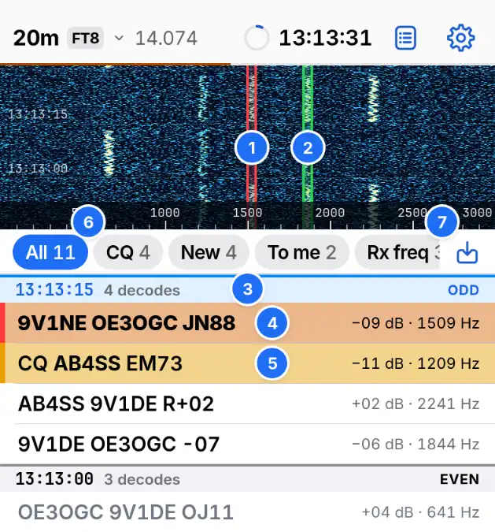

# Operate

Operate is where you work stations: the waterfall at the top, the decode list under it and the [transmit controls](making-qsos.md) at the bottom.

1. Tx, in red. Tap or drag on the waterfall to move it.
2. Rx, in green. Start a drag on it to move it.
3. Slot bar, with the slot's UTC start, its decode count and its parity.
4. A message to you, marked with a red left edge.
5. A CQ.
6. Filters.
7. Saves a recent slot as a recording.

## The waterfall

The waterfall shows 0 to 3000 Hz, with the newest signals at the top. Tx moves in 5 Hz steps and stays within 200 to 2800 Hz in FT8, or 200 to 2767 Hz in FT4. With a mouse, click to set Tx and Shift-click to set Rx. To get away from other signals, use Find clear Tx in •••, which moves Tx to the quietest part.

## The decode list

The list keeps an hour of slots with the newest at the top, and it stops scrolling while you touch it. Once you're working a station, rows that have nothing to do with that QSO dim.

## Selecting and calling

| Action | Touch | Mouse or keyboard |
| --- | --- | --- |
| Select, and move Rx | Tap | Click, or the up and down arrows |
| Call | Double-tap | Double-click, or Return |
| Open the station's sheet | Touch and hold | Right-click |

Calling a station leaves Tx where it is, because Hold Tx frequency in Settings › FT8 and FT4 is on by default. Turn it off and calling moves Tx to the station's frequency as well.

## Colours

Each row takes the colour of the first category it matches. The default scheme checks them in this order: My call, New grid, New call, Ending a QSO, CQ, Sent and Worked before. Change the categories in Settings › Decode colours.

## Marks and tags

| Mark | Meaning |
| --- | --- |
| Solid grey bar at the right | A dupe, worked today on this band and mode |
| Bar in the New call colour | Worked on another day |
| Lost | The station you called answered another |
| Next, 2nd, 3rd | Callers waiting while Repeat CQ runs |
| Dupe | A caller Repeat CQ skips |
| A reference, such as SG-0014 | The station you tapped Go on in Spots, for 60 min |

## Filters

| Chip | Shows |
| --- | --- |
| All | Every decode |
| CQ | CQ calls |
| New | Decodes marked by one of the New colour categories |
| To me | Messages with your callsign |
| Rx freq | Decodes within 10 Hz of Rx |
| Hide worked | Every decode except dupes, though messages to you always show |
| Sort | Each slot sorted by kind of message, then by frequency |

On an iPad or a computer the list splits into Band activity and Rx frequency. Rx frequency holds decodes within 50 Hz of Rx, messages to you and your own transmissions.
