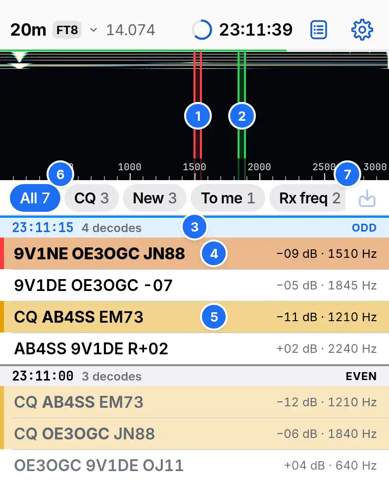

# Operate

Operate holds the waterfall, the decode list and the [transmit controls](making-qsos.md).

1. Tx, red. Tap or drag on the waterfall to move it.
2. Rx, green. Start a drag on it to move it.
3. Slot bar: UTC start, decode count and parity.
4. A message to you, with a red left edge.
5. A CQ.
6. Filters.
7. Save a recent slot as a recording.

## The waterfall

The waterfall runs from 0 to 3000 Hz, newest at the top. Tx moves in 5 Hz steps within 200 to 2800 Hz in FT8 and 200 to 2767 Hz in FT4. With a mouse, click sets Tx and Shift-click sets Rx. Find clear Tx, in •••, moves Tx to the quietest part.

## The decode list

The list keeps an hour of slots, newest first, and holds still while you touch it. Rows unrelated to the station you work dim.

## Selecting and calling

| Action | Touch | Mouse or keyboard |
| --- | --- | --- |
| Select, and move Rx | Tap | Click, or the up and down arrows |
| Call | Double-tap | Double-click, or Return |
| Open the station's sheet | Touch and hold | Right-click |

Hold Tx frequency, in Settings › FT8 and FT4, keeps Tx where it is when you call. It is on by default.

## Colours

Settings › Decode colours sets the categories. The first that matches tints the row. The default scheme marks, in order: My call, New grid, New call, Ending a QSO, CQ, Sent and Worked before.

## Marks and tags

| Mark | Meaning |
| --- | --- |
| Solid grey bar at the right | A dupe, worked today on this band and mode |
| Bar in the New call colour | Worked on another day |
| Lost | The station you called answered another |
| Next, 2nd, 3rd | Callers waiting while Repeat CQ runs |
| Dupe | A caller Repeat CQ skips |
| A reference, such as SG-0014 | The station you tapped Go on in Spots, for 60 min |

## Filters

| Chip | Shows |
| --- | --- |
| All | Every decode |
| CQ | CQ calls |
| New | Decodes a New colour category marks |
| To me | Messages with your callsign |
| Rx freq | Decodes within 10 Hz of Rx |
| Hide worked | Every decode but dupes. Messages to you stay |
| Sort | Each slot by kind of message, then by frequency |

On an iPad or a computer the list splits into Band activity and Rx frequency, which holds decodes within 50 Hz of Rx, messages to you and your own.
