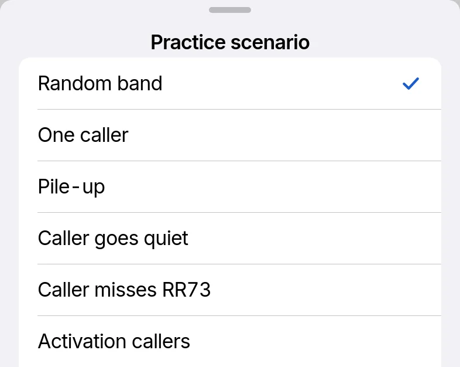

# Practice band

Practice band, in Settings › Practice band, runs a simulated band of FT8, FT4, LQ8 and RTTY stations with no radio. Operate shows a Practice badge. Call CQ, call stations and Hunt as on the air.

## Scenarios

Practice scenario, in ••• on Operate, sets how the stations you work behave. The rest of the band carries on.

| Scenario | Stations |
| --- | --- |
| Random band, the default | Each behaves as on a real band |
| One caller | 1 answers a CQ and completes the QSO |
| Pile-up | 3 to 5 answer a CQ at once and keep calling |
| Caller goes quiet | The caller stops after the report |
| Caller misses RR73 | The caller sends the R-report again |
| Activation callers | 1 answers each CQ, and another tail-ends most QSOs |
| Weak and crowded | 1 to 3 callers near −22 dB in raised noise |
| Station answers | A station calling CQ answers you |
| Station works another | A station works another, then answers the next call |
| Station answers someone else | The station you call answers another caller each time |
| Station never answers | A station calling CQ never answers you |
| CQ DX and CQ NA | They answer only the stations they asked for |
| Hunt: busy band | Many CQs. Those weaker than −10 dB do not hear you |
| Hunt: a station calls you | The station you call stays silent and another calls you |
| Contest exchanges | CQ FD, CQ RU and CQ TEST, with callers in each format |
| Worked stations | The practice log gets earlier QSOs with stations on the band |
| New ones | CQs from DXCC entities, zones and grids not in the practice log |
| Clock off | Every station is 1.5 s early or late |
| Fox (DXpedition) | A Fox works 3 Hounds a slot. Turn on Hound to work it |

In LQ8 the stations run LQ8's 4-message QSO. Contest exchanges and Fox are FT8 and FT4 only, and Caller misses RR73 is Caller misses R-report: the caller calls again after your first R-report.

## Tx audio and the radio

Play Tx audio, on by default, plays practice transmissions and keys a connected radio. Off, the radio stays silent and unkeyed.

## The practice log

Practice QSOs go to the practice log, which Log shows while the practice band is on. Clear practice log, in Settings › Practice band, empties it, with Undo. Wavelog reads, PSK Reporter reports and Web SDR pause, and backup and import wait until the practice band is off.
