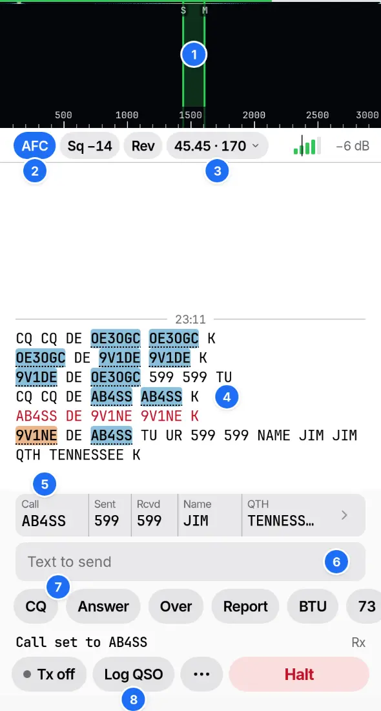

# RTTY

Choose RTTY in Change band and type the dial in MHz or kHz. RR73 keeps your dial for each band. The default is 45.45 baud with a 170 Hz shift.

1. The mark and space pair. Tap near a signal to tune to it, or drag the pair.
2. AFC, the squelch and Rev.
3. Speed and shift.
4. Callsigns, in their decode colours. Tap one to make it the QSO's call.
5. The QSO strip, filled in from the station's text. Tap a field to edit it.
6. The text to send. Return sends the line.
7. Macros. F1 to F12 send them too.
8. Log QSO.

## Sending

Tap Tx off to start sending the queue, and On air to stop once it is sent. Halt ends a transmission at once and turns Repeat CQ off. Unsent text stays in the field.

## Macros

Settings › Macros holds a QSO set and a Contest set. ••• on Operate switches between them. A macro sends its Text with these fields filled in: `{CALL}`, `{NAME}`, `{QTH}`, `{RST}`, `{NR}`, `{EXCH}`, `{MYCALL}`, `{MYNAME}`, `{MYQTH}`, `{MYGRID}` and `{UTC}`.

## Repeat CQ

Repeat CQ, in •••, sends the macro labelled CQ after each gap, 3 s by default. Text arriving in a gap, typing, a macro or a tap on Tx stops it.

## Contest

| Setting, in Settings › RTTY › Contest | Example |
| --- | --- |
| Contest: the log's CONTEST_ID | CQ-WPX-RTTY |
| Next serial: the number `{NR}` sends next | 42 |
| Serial digits | 3 sends 042 |
| Exchange: what `{EXCH}` sends | `599 {NR}`, the default |

## Settings › RTTY

| Group | Settings |
| --- | --- |
| Signal | Speed, Shift, Reverse, Unshift on space, Figures (US or ITA2) |
| Receive | AFC, Squelch |
| Transmit | Stop bits, Preamble, Idle, Tail, Start each Tx with a new line, Stop idle Tx after (60 s), Watchdog (10 min), Repeat CQ gap |
