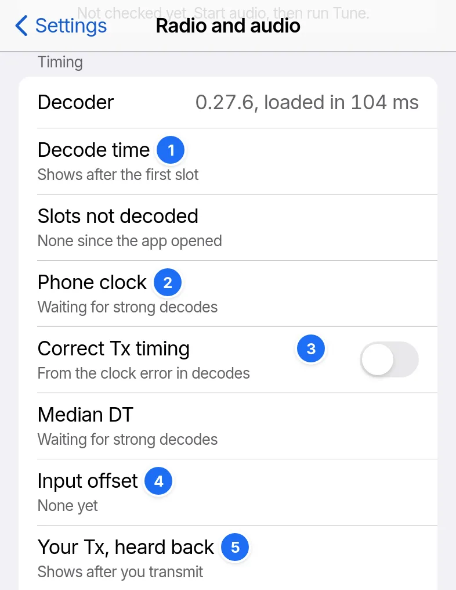

# Timing and the clock

FT8 and FT4 transmissions start 0.5 s into their UTC slot, so the device's clock sets when RR73 transmits.

1. Decode time: the last slot's, and the time 95% of slots decode within.
2. The clock error, from the median DT of decodes at −10 dB and above.
3. Correct Tx timing.
4. Input offset: the correction RR73 learns for receive audio.
5. The DT of your own transmission, heard back.

Copy timing report, at the end of the list, copies it all as text.

## The Clock badge

The Clock badge shows on Operate's bar from 1 s off, with a status line such as `Phone clock 1.2 s slow`, and goes once the clock is within 0.8 s. A slow audio input gives the same reading.

## Setting the clock

| System | Setting |
| --- | --- |
| iPhone | Settings › General › Date & Time › Set Automatically, with a network |
| Windows | Settings › Time & language › Date & time › Set time automatically, then Sync now |
| Others | Automatic date and time in the system settings |

## Correct Tx timing

Correct Tx timing moves each transmission by the clock error. It is off by default. Receive needs no setting: the input offset moves at most 0.08 s per slot, within ±2.5 s.

## The desktop app's time server

The desktop app measures the clock against an NTP time server at start and every 10 min, and corrects the time RR73 uses. Time server empty uses the public NTP pool. Correct with time server off contacts no server.
