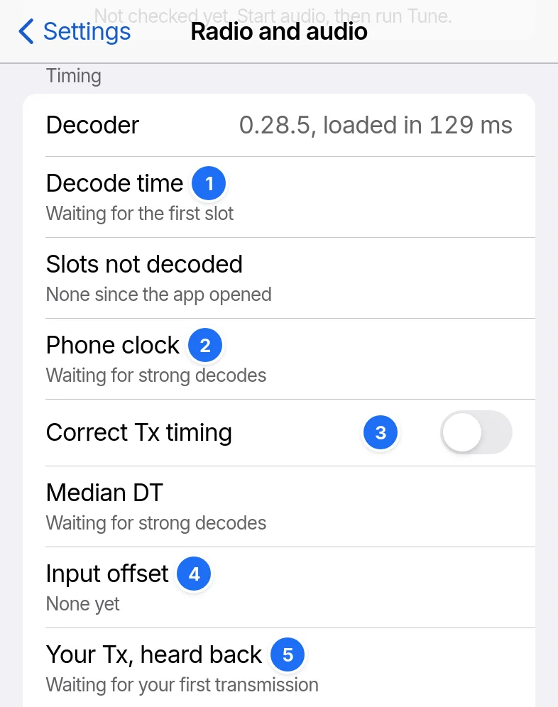

# Timing and the clock

FT8 and FT4 transmissions start 0.5 s into their UTC slot, so the device's clock decides when RR73 transmits.

1. Decode time for the last slot, and the time 95% of slots decode within.
2. The clock error, from the median DT of decodes at −10 dB and above.
3. Correct Tx timing.
4. Input offset, the correction RR73 learns for receive audio.
5. The DT of your own transmission, heard back.

Copy timing report, at the end of the list, copies all of this as text.

## The Clock badge

The Clock badge appears on Operate's bar once the clock is 1 s off, with a status line such as `Phone clock 1.2 s slow`, and goes again once the clock is within 0.8 s. A slow audio input gives the same reading as a slow clock.

## Setting the clock

| System | Setting |
| --- | --- |
| iPhone | Settings › General › Date & Time › Set Automatically, with a network |
| Windows | Settings › Time & language › Date & time › Set time automatically, then Sync now |
| Others | Automatic date and time in the system settings |

## Correct Tx timing

Correct Tx timing, off by default, moves each transmission by the clock error. Receive needs no setting, because the input offset follows the error by itself, at most 0.08 s per slot and within ±2.5 s.

## The desktop app's time server

The desktop app measures the clock against an NTP time server when it starts and every 10 min, and corrects the time RR73 uses. With Time server empty it uses the public NTP pool. Turn off Correct with time server and it contacts no server.
