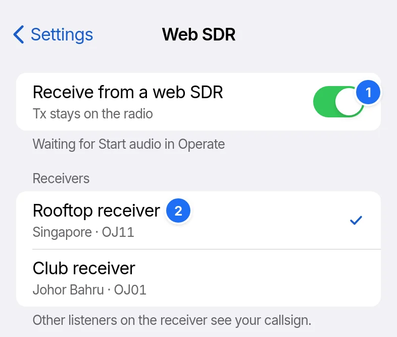

# Web SDR and the relay

A web SDR can supply receive audio while transmit audio still goes to your radio. RR73 comes with no relay, and reaches web SDRs and PSK Reporter only through one you add.

## The relay

1. In Settings › Relay, tap Add relay.
2. Type the relay's https API base as Address.
3. If the relay needs one, type its Access key.
4. Choose the relay and tap Test relay.

## Receiving from a web SDR

1. Receive from a web SDR. With it on, Start audio on Operate receives from the web SDR.
2. The receiver, from the relay's list. Other listeners on that receiver see your callsign.

The receiver follows the band's dial, and pauses while the practice band is on.

## PSK Reporter

Report to PSK Reporter, in Settings › PSK Reporter, sends your decodes through a relay that reports to PSK Reporter. Show who heard you needs no relay, and lists on Spots the stations that heard you in the last 30 min.
