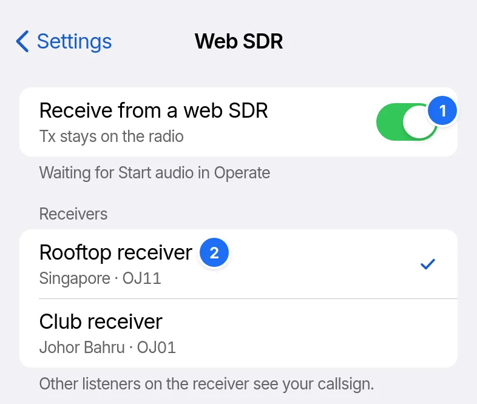

# Web SDR and the relay

A web SDR can supply receive audio while transmit audio goes to the radio. RR73 reaches web SDRs and PSK Reporter through a relay you add. It comes with none.

## The relay

In Settings › Relay, tap Add relay, type the relay's https API base as Address, choose the relay and tap Test relay. Type the Access key if the relay needs one.

## Receiving from a web SDR

1. Receive from a web SDR. Start audio on Operate then receives from it.
2. The receiver, from the relay's list. Other listeners on it see your callsign.

The receiver follows the band's dial. It pauses while the practice band is on.

## PSK Reporter

Report to PSK Reporter, in Settings › PSK Reporter, sends your decodes through a relay that reports. Show who heard you lists on Spots the stations that heard you in the last 30 min, and needs no relay.
