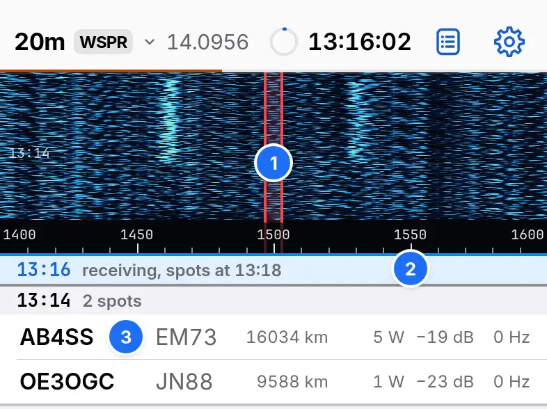

# WSPR

WSPR sends and receives low-power beacons for checking propagation. Choose WSPR in Change band. Its slots are 2 min long and start on each even UTC minute.

1. Tx frequency, within 1410 to 1590 Hz. Tap or drag to set it.
2. The slot under way, and when its spots arrive.
3. A spot, with callsign, grid, distance, power, SNR and drift. Tap it to mark its trace on the waterfall, or touch and hold for its details.

## The beacon

| Control | Effect |
| --- | --- |
| Beacon | Turns the beacon on or off. It reads Tx at :06 while a transmission waits, and On air while transmitting |
| Tx percentage | The share of slots it transmits in, from 5% to 100%, with 20% by default |
| Halt | Ends a transmission and turns the beacon off |

A transmission starts 1 s into its slot and lasts about 110.6 s. At 20%, 2 to 8 receive slots go by between transmissions. The watchdog doesn't stop the beacon, so Stop beacon after sets how long it runs.

## Settings › WSPR

| Setting | Default |
| --- | --- |
| Reported power, 0 to 60 dBm | 37 dBm (5 W) |
| Stop beacon after, 30 min to 12 h | 1 h |
| Sort spots by: Distance, SNR or Callsign | Distance |
| Upload spots to WSPRnet | Off |

The beacon builds its message from your callsign, grid and power. With a compound callsign, the grid goes out only if you've entered a 6-character grid.
