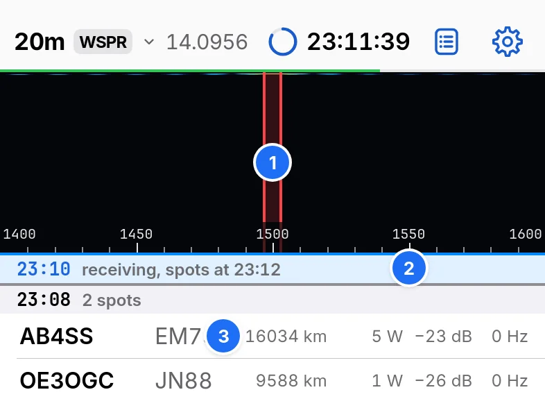

# WSPR

Choose WSPR in Change band. Slots are 2 min long, from each even UTC minute.

1. Tx frequency, 1410 to 1590 Hz. Tap or drag to set it.
2. The slot under way, and when its spots arrive.
3. A spot: callsign, grid, distance, power, SNR and drift. Tap it to mark its trace, or touch and hold for its details.

## The beacon

| Control | Effect |
| --- | --- |
| Beacon | Turns the beacon on or off. It reads Tx at :06 while a transmission waits, and On air while transmitting |
| Tx percentage | The share of slots it transmits in, 5% to 100%. 20% by default |
| Halt | Ends a transmission and turns the beacon off |

A transmission starts 1 s into its slot and lasts about 110.6 s. At 20%, 2 to 8 receive slots separate transmissions. The watchdog does not stop the beacon. Stop beacon after does.

## Settings › WSPR

| Setting | Default |
| --- | --- |
| Reported power, 0 to 60 dBm | 37 dBm (5 W) |
| Stop beacon after, 30 min to 12 h | 1 h |
| Sort spots by: Distance, SNR or Callsign | Distance |
| Upload spots to WSPRnet | Off |

The beacon's message comes from your callsign, grid and power. A compound callsign sends its grid only with a 6-character grid.
