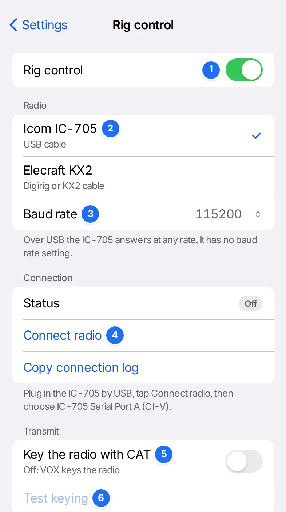

# Your radio

RR73 sends and receives audio through the device's audio input and output. It keys the radio by VOX, or by CAT with rig control.

## iPhone and VOX

1. Connect the phone's headset audio to the radio's audio in and out, through the headset jack or a USB-C or Lightning headset adapter.
2. Set the radio to USB with VOX on.
3. Set the radio's dial to the one Change band shows.

Before you transmit, in Settings › Radio and audio, is a checklist. Its Keying check passes when receive audio drops while the start chime or Tune plays.

## Receive audio

| Setting | Effect |
| --- | --- |
| Input | The audio input. System default uses the device's choice |
| Level | Keep band noise inside −30 to −14 dBFS, with the radio's AGC on |
| Waterfall contrast | Low, Normal or High |

## Transmit audio

| Setting | Effect |
| --- | --- |
| Output | Where transmit audio goes, in Chrome and Edge. Safari plays to the system output |
| Monitor | Plays transmit audio on a second output too |
| Start chime | A tone when audio starts. It keys the radio by VOX |

## Setting levels with Tune

Tune for 10 s, in Settings › Radio and audio or in Operate's •••, plays a tone at your Tx frequency. Set Output level to 4 to 5 bars of ALC on a KX2, or within the ALC zone on an IC-705.

## Rig control in Chrome or Edge

1. Rig control on.
2. The radio: an IC-705 over its USB cable, or a KX2 through a Digirig or KX2 cable.
3. Baud rate, for the KX2: its MENU › RS232 setting, 4800 by default.
4. Connect radio, then the port: IC-705 Serial Port A (CI-V), the Digirig's CP210x port or the KX2 cable's port.
5. Key the radio with CAT. Off, VOX keys the radio.
6. Test keying transmits for 1 s with no audio. Use low power into a dummy load.

Once connected, Change band sets the radio's dial and data mode.

## Keying by CAT

Choose the radio's own audio device as Output in Settings › Radio and audio. With System default, nothing transmits.

Keep Tx audio centred, on the IC-705, moves the dial in 500 Hz steps for a Tx frequency outside 1500 to 2000 Hz. The signal then stays in the middle of the transmit passband.

| Status line | Action |
| --- | --- |
| `No Tx output chosen` | Choose the radio's audio device as Output |
| `Set USB SEND to OFF` | Set the IC-705's USB SEND to OFF |
| `No reply from radio · Tx off` | Check the cable. Tx went off |
| `PTT off not confirmed · unkey radio` | Unkey the radio by hand |

The KX2 has no transmit time-out.

## The desktop app

The desktop app has rig control on Windows, macOS and Linux, and checks the clock against [a time server](timing.md#the-desktop-app-s-time-server). The installers on each GitHub release are not signed.

| System | File | First start |
| --- | --- | --- |
| Windows | `.exe` or `.msi` | At Windows protected your PC, select More info, then Run anyway |
| macOS | `.dmg` | Drag RR73 to Applications and open it once. Then select Open Anyway in System Settings › Privacy & Security |
| Linux | `.AppImage` or `.deb` | For rig control, add your user to the `dialout` group (`uucp` on Arch Linux) and log in again |
