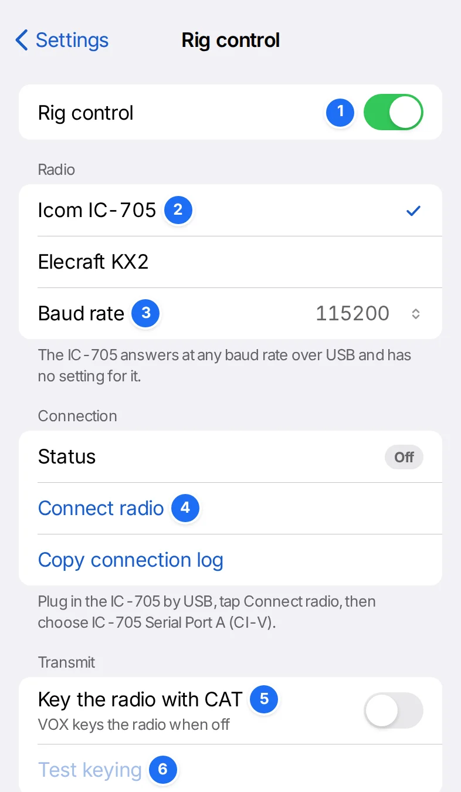

# Your radio

RR73 sends and receives audio through the device's audio input and output, and keys the radio by VOX, or by CAT when rig control is on.

## iPhone and VOX

1. Connect the phone's headset audio to the radio's audio in and out, through the headset jack or a USB-C or Lightning headset adapter.
2. Set the radio to USB with VOX on.
3. Set the radio's dial to the one Change band shows.

Then go through the Before you transmit checklist in Settings › Radio and audio. Its Keying check passes when receive audio drops while the start chime or Tune plays, which shows the radio keyed.

## Receive audio

| Setting | Effect |
| --- | --- |
| Input | The audio input. System default takes whatever the device chooses |
| Level | Keep band noise inside −30 to −14 dBFS, with the radio's AGC on |
| Waterfall contrast | Low, Normal or High |

## Transmit audio

| Setting | Effect |
| --- | --- |
| Output | Where transmit audio goes, in Chrome and Edge. Safari plays to the system output |
| Monitor | Plays transmit audio on a second output too |
| Start chime | A tone when audio starts. It keys the radio by VOX |

## Setting levels with Tune

1. Tap Tune for 10 s, in Settings › Radio and audio or in Operate's •••. It plays a tone at your Tx frequency.
2. While it plays, set Output level for 4 to 5 bars of ALC on a KX2, or within the ALC zone on an IC-705.

## Rig control in Chrome or Edge

1. Rig control.
2. The radio: an IC-705 on its USB cable, or a KX2 through a Digirig or a KX2 cable.
3. Baud rate, for the KX2 only. Match the radio's MENU › RS232 setting, which is 4800 by default.
4. Connect radio, then choose the port: IC-705 Serial Port A (CI-V), the Digirig's CP210x port or the KX2 cable's port.
5. Key the radio with CAT. With it off, VOX keys the radio.
6. Test keying, which transmits for 1 s with no audio. Use low power into a dummy load.

Once the radio is connected, Change band sets its dial and data mode.

## Keying by CAT

With CAT keying, choose the radio's own audio device as Output in Settings › Radio and audio. Left on System default, nothing transmits.

On the IC-705, Keep Tx audio centred moves the dial in 500 Hz steps whenever the Tx frequency is outside 1500 to 2000 Hz, so the signal stays in the middle of the radio's transmit passband.

| Status line | Action |
| --- | --- |
| `No Tx output chosen` | Choose the radio's audio device as Output |
| `Set USB SEND to OFF` | Set the IC-705's USB SEND to OFF |
| `No reply from radio · Tx off` | Check the cable. Tx went off |
| `PTT off not confirmed · unkey radio` | Unkey the radio by hand |

The KX2 has no transmit time-out of its own.

## The desktop app

The desktop app gives you rig control on Windows, macOS and Linux and checks the clock against [a time server](timing.md#the-desktop-app-s-time-server). Download the installer for your system from a GitHub release. The installers aren't signed, so each system warns you the first time.

| System | File | First start |
| --- | --- | --- |
| Windows | `.exe` or `.msi` | At Windows protected your PC, select More info, then Run anyway |
| macOS | `.dmg` | Drag RR73 to Applications and open it once. Then select Open Anyway in System Settings › Privacy & Security |
| Linux | `.AppImage` or `.deb` | For rig control, add your user to the `dialout` group (`uucp` on Arch Linux) and log in again |

## Desktop app updates

The desktop app looks for a newer release on GitHub when it starts and once a day after that. When it finds one, a notice names the new version once, and Settings › About shows Open release page until you install it. The app never installs anything itself:

1. Tap the notice or Open release page. The release page opens in your browser.
2. Download the installer for your system.
3. Install it the way you installed the first one.

A check that fails shows nothing. To stop the checks, turn off Check for new versions in Settings › About.
